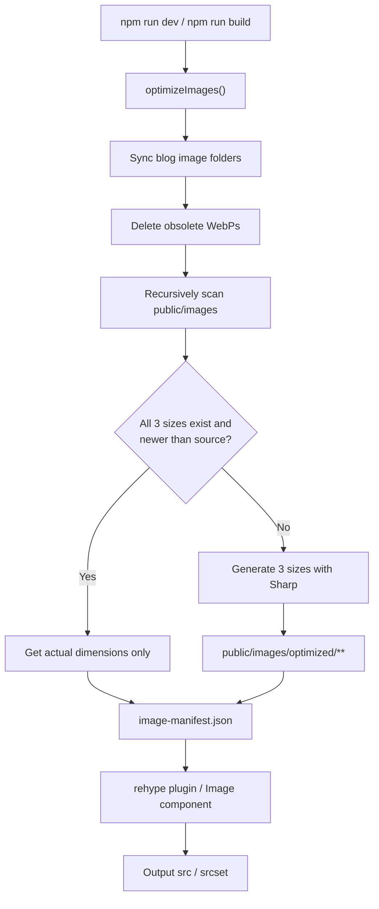

This site uses Next.js with Static Site Generation (SSG). Everything—from article images to the homepage gallery—lives directly in the repository.  
Initially, I relied on `next/image`. However, Vercel’s free tier imposes limits on image optimization requests. I didn't want to worry about quota limits while maintaining my portfolio, so I replaced it with a custom image optimization pipeline built with Sharp.

In this post, I'll walk through why I decided to build it myself, how the pipeline is designed, and how I tackled an issue with `srcset` width descriptors along the way.

---

## Why Drop next/image

`next/image` transforms images on-demand on Vercel's edge and serves them via CDN. While convenient, every transformation counts toward the monthly free quota.

For this site, the image workflow had several specific characteristics:

- All images are local repository files; no external images are fetched.
- Both articles and the gallery are fully determined at build time via SSG.
- Display sizes have very little variation—basically just the content width and thumbnails.

In other words, on-demand conversion on every request is unnecessary. Generating WebP variants once at build time and serving them as plain static files is more than enough. I set `images.unoptimized: true` in `next.config.ts` and stopped relying on `next/image` runtime transformations.

> [!NOTE]
> Maintaining an in-house pipeline means taking full responsibility for adding new image sizes or handling AVIF support down the road. Still, I prioritized low-latency static delivery without worrying about request quotas over out-of-the-box convenience.

---

## Design

Each source image is converted into three WebP variants:

| Variant  | Width  | Quality | Primary Use Case                       |
| -------- | ------ | ------: | -------------------------------------- |
| `thumb`  | 480px  |      80 | Thumbnails in lists, small images      |
| `medium` | 800px  |      82 | Article body (max 624px display width) |
| `large`  | 1280px |      85 | High-DPR devices, full-screen display  |

The design principles are straightforward:

- Never upscale beyond the original dimensions (`withoutEnlargement: true`)
- WebP-only output
- Store generated files in `public/images/optimized/`, mirroring the original directory structure
- Authors reference original image paths; the rendering side automatically resolves the optimized URLs

For `thumb`, the quality is dialed back slightly, whereas `large` has its quality bumped up to prevent visible compression artifacts when viewed enlarged. I set `effort` to 4. Sharp supports values from 0 to 6; higher values yield better compression ratios at the cost of processing time, making 4 a practical sweet spot for build-time execution.

```javascript
const SIZES = [
  { name: "thumb", width: 480, quality: 80 },
  { name: "medium", width: 800, quality: 82 },
  { name: "large", width: 1280, quality: 85 },
];
```

---

## Pipeline Overview

The optimization script runs on `npm run dev` startup and during the `prebuild` hook right before `npm run build`.



Both the generated assets and the manifest file are committed to git. Although the script still runs during Vercel builds, existing images are detected and skipped, resulting in almost zero impact on deployment build times.

---

## Implementation Highlights

### Incremental Builds

Transforming every image on every run would make `npm run dev` noticeably slower as the image count grows. To prevent this, the script checks if all three sizes exist and are newer than the original file before deciding whether to skip:

```javascript
let needOptimization = false;
for (const size of SIZES) {
  const outputFilePath = path.join(
    targetOutputDir,
    `${baseName}-${size.name}.webp`,
  );
  if (!fs.existsSync(outputFilePath)) {
    needOptimization = true;
    break;
  }
  const outputStat = fs.statSync(outputFilePath);
  if (outputStat.mtimeMs < originalStat.mtimeMs) {
    needOptimization = true;
    break;
  }
}
```

Even when conversion is skipped, the script still reads the dimensions of the original image to construct the manifest described later.

### Asset Cleanup

When you replace or delete an image, stale WebP files can linger under `optimized/`. If left unchecked, this bloats repository size with dead assets.

The cleanup phase recursively scans `optimized/`, reconstructs the original path from filenames like `foo-medium.webp`, and verifies whether a matching source image (`jpg / jpeg / png / webp`) still exists. If missing, it deletes the generated files along with any empty directories.

```javascript
const match = entry.name.match(/^(.+)-(thumb|medium|large)\.webp$/i);
if (match) {
  const originalExists = EXTENSIONS.some((ext) =>
    fs.existsSync(path.join(originalDir, `${match[1]}${ext}`)),
  );

  if (!originalExists) {
    fs.unlinkSync(fullPath);
  }
}
```

### Folder Sync

Blog images are placed under `public/images/blog/<slug>/`. Manually creating a directory each time you write a new post is easy to forget, so the script scans `content/blog/<slug>.md` and automatically creates corresponding image folders. If a post is removed, its folder and cached WebPs are cleaned up automatically.

```javascript
for (const slug of activeSlugs) {
  const targetDir = path.join(BLOG_IMAGES_DIR, slug);
  if (!fs.existsSync(targetDir)) {
    fs.mkdirSync(targetDir, { recursive: true });
  }
}
```

Note that the `common/` directory is explicitly excluded from deletion so shared assets can be reused across multiple posts.

### Dev Watcher

Manually re-running the script whenever adding an image during local development is tedious. Instead, `fs.watch` monitors `public/images/` and triggers re-optimization with a 300ms debounce:

```javascript
fs.watch(BASE_IMAGE_DIR, { recursive: true }, (eventType, filename) => {
  if (filename && filename.startsWith("optimized")) {
    return;
  }

  clearTimeout(optimizeTimeout);
  optimizeTimeout = setTimeout(() => {
    optimizeImages();
  }, 300);
});
```

Ignoring events inside `optimized/` is crucial; otherwise, newly created WebP files will trigger watch events and cause an infinite loop.

---

## The srcset Width Trap

This was where I spent the most time debugging.

Initially, I hardcoded width descriptors in `srcset` as `480w / 800w / 1280w`. However, because `withoutEnlargement: true` is enabled, an image with an original width of only 700px produces both `medium` and `large` files at 700px. Claiming that this file is `1280w` introduces a discrepancy between the descriptor and the actual file dimensions.

On high-DPR screens (like smartphones), the browser selects the optimal candidate by computing `displayed width × DPR`. If you tell the browser an image is 1280px wide when it is actually only 700px, the browser falsely assumes it has enough resolution and selects it. As a result, higher-density displays end up stretching a lower-resolution file, making images appear blurry.

A width descriptor is meaningless unless it reflects the actual pixel width of the file.

To solve this, I recorded the actual generated dimensions into a JSON manifest and used those exact values for the `srcset` descriptors:

```json
{
  "blog/building_my_personal_website/gallery.png": {
    "thumb": 480,
    "medium": 772,
    "large": 772
  }
}
```

This manifest is generated automatically by `scripts/optimize-images.mjs` during the build, requiring no manual editing.

Furthermore, the image component deduplicates variants that ended up with identical widths before generating `srcset`. In the scenario above, declaring both `medium` and `large` as `700w` serves no purpose.

```typescript
const byWidth = new Map<number, string>();
for (const name of VARIANT_ORDER) {
  const width = widths[name];
  if (typeof width === "number" && width > 0) {
    byWidth.set(width, srcFor(name));
  }
}

const candidates = [...byWidth.entries()].sort(([a], [b]) => a - b);
```

For images not listed in the manifest, the component falls back to using just `medium` without misrepresenting widths.

---

## Path Rewriting

In Markdown, authors simply write standard paths pointing to the source image:

```markdown

```

During HTML transformation, a custom rehype plugin swaps these references for optimized WebP paths under `/images/optimized/...` and attaches `srcset`. Content writers never have to think about optimized paths.

```typescript
function rehypeOptimizeImages() {
  return (tree: HastRoot) => {
    // Traverse 
    // Attach src / srcSet / sizes / loading / decoding
  };
}
```

The `sizes` attribute matches the article content container. The body width is constrained by Tailwind CSS's `max-w-2xl` (672px) with 24px horizontal padding, making the maximum display width 624px:

```typescript
export const RESPONSIVE_IMAGE_SIZES =
  "(min-width: 672px) 624px, calc(100vw - 48px)";
```

However, images that explicitly define a `width` attribute or an inline `style="width: ..."` do not receive this `sizes` rule. Mismatches between explicit dimensions and the `sizes` directive would cause the browser to pick the wrong candidate.

When rendering images directly in JSX, I use `@/components/common/Image` instead of `next/image`. It shares the same path-resolution logic as the rehype plugin, applying `loading="lazy"` and `decoding="async"` by default unless `priority` is specified.

---

## Results

Comparing file sizes before and after shows that `medium` variants (used in article content) are reduced to just a small fraction of their original size:

| Source File     | Original Size | medium |   large | medium Reduction |
| --------------- | ------------: | -----: | ------: | ---------------: |
| `sample(1).jpg` |     1,040.6KB | 73.4KB | 225.1KB |             ~93% |
| `sample(2).jpg` |     4,862.2KB | 53.7KB | 151.7KB |             ~99% |

Even when source photos are several megabytes, the actual payload downloaded in the article stays well under a few hundred kilobytes. Since conversion happens only once at build time, runtime delivery is just plain static file hosting—no request counters or quota worries.

The images embedded in this article are processed through this exact pipeline. Below are two sample images; what you see rendered in the browser are the auto-generated `medium` WebP files.

<figure>
  
  <figcaption>sample(1).jpg: 2600×1548 / 1,040.6KB → medium 800px / 73.4KB (~93% reduction)</figcaption>
</figure>

<figure>
  
  <figcaption>sample(2).jpg: 7360×4912 / 4,862.2KB → medium 800px / 53.7KB (~99% reduction)</figcaption>
</figure>

Interestingly, `sample(2)` (a 36MP image) resulted in a smaller file than `sample(1)` due to differences in original compression and image details. Optimization ratios depend not only on resolution, but also heavily on the encoding characteristics of the source file.

---

## Trade-offs & Next Steps

Going the custom route comes with trade-offs:

- **Fixed at 3 sizes**: Lacks the flexibility of `next/image` to generate arbitrary widths on the fly.
- **No AVIF support yet**: Sharp supports AVIF, so I may introduce it if the compression gains prove worthwhile.
- **Build times scale with image count**: Incremental skips mitigate this for now, but a significantly larger library would require a more scalable architecture.

Future enhancements I’m considering include adding AVIF support, implementing content-hash cache busting in filenames, and generating low-quality image placeholders (LQIP).

---

## Conclusion

Outsourcing image optimization to a framework is easy, but it can feel restrictive when you want granular control over request budgets and conversion timing.

This custom pipeline boils down to three core ideas:

- Keep source images in organized directories; Markdown files only reference original paths.
- Generate three WebP sizes along with an actual-dimension manifest at build time.
- Let rendering components look up the manifest to construct accurate `srcset` attributes.

The biggest win was eliminating ongoing hosting costs without adding overhead to the writing experience. Most importantly, capturing actual dimensions in the manifest resolved the subtle bug where smaller source images suffered from quality degradation on high-DPR screens.
