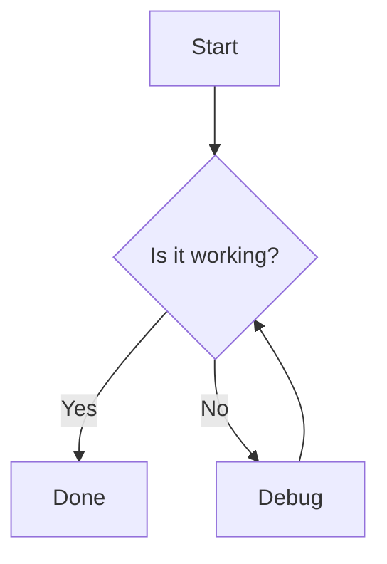
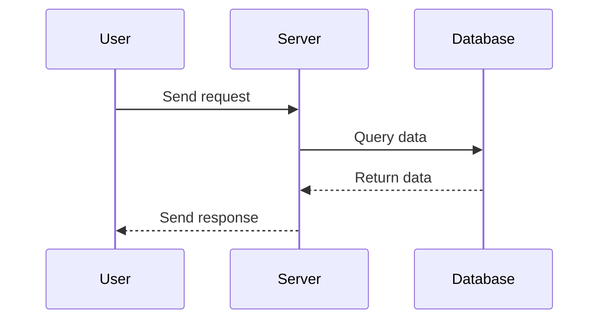
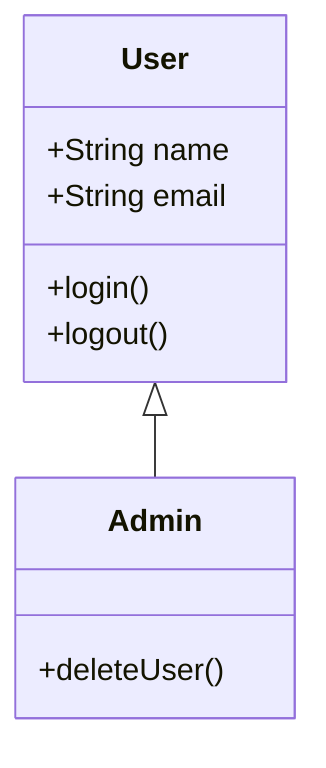

## 1. Headings

# Heading 1

## Heading 2

### Heading 3

#### Heading 4

##### Heading 5

###### Heading 6

---

## 2. Text Formatting

**Bold text**

_Italic text_

**_Bold and italic text_**

~~Strikethrough text~~

`Inline code`

**Bold text with _nested italic_**

---

## 3. Links

[OpenAI](https://www.openai.com)

[Example](https://example.com "Example title")

<https://example.com>

<someone@example.com>

Reference-style link: [Markdown Guide][guide]

[guide]: https://www.markdownguide.org/

---

## 4. Paragraphs

This is the first paragraph.

This is the second paragraph.

This line ends with two spaces.  
This line starts on a new line.

---

## 5. Blockquotes

> This is a blockquote.

> This is a multi-line blockquote.
>
> It can contain multiple paragraphs.

> You can also nest blockquotes.
>
> > This is a nested blockquote.

---

## 6. Unordered Lists

- Apple
- Banana
- Orange
- Mango

### Nested Lists

- Frontend
  - HTML
  - CSS
  - JavaScript
- Backend
  - Python
  - Java
  - Go
- Database
  - PostgreSQL
  - MySQL
  - SQLite

---

## 7. Ordered Lists

1. First item
2. Second item
3. Third item
4. Fourth item

### Nested Ordered Lists

1. Prepare the environment.
   1. Install dependencies.
   2. Configure the project.
   3. Run the tests.
2. Build the application.
3. Deploy the application.

---

## 8. Task Lists

- [x] Create the project
- [x] Install dependencies
- [x] Write documentation
- [ ] Add unit tests
- [ ] Deploy to production

---

## 9. Code

Inline code:

`console.log("Hello, world!");`

### JavaScript

```javascript
function greet(name) {
  return `Hello, ${name}!`;
}

const message = greet("Alice");
console.log(message);
```

### Python

```python
def greet(name):
    return f"Hello, {name}!"

print(greet("Alice"))
```

### JSON

```json
{
  "name": "Alice",
  "age": 30,
  "active": true,
  "skills": ["Python", "JavaScript", "Markdown"]
}
```

### Bash

```bash
npm install
npm run build
npm test
```

### HTML

```html
<!DOCTYPE html>
<html lang="en">
  <head>
    <title>Hello</title>
  </head>
  <body>
    <h1>Hello, world!</h1>
  </body>
</html>
```

### CSS

```css
.container {
  display: flex;
  justify-content: center;
  align-items: center;
}
```

### SQL

```sql
SELECT
    id,
    name,
    email
FROM users
WHERE active = true
ORDER BY name ASC;
```

---

## 10. Code Block Without Language

```
This is a plain code block.

    Indentation is preserved.
    Line breaks are preserved.

No syntax highlighting is specified.
```

---

## 11. Horizontal Rules

---

---

---

---

## 12. Tables

| Name  | Age | Role      |
| ----- | --: | --------- |
| Alice |  30 | Developer |
| Bob   |  25 | Designer  |
| Carol |  35 | Manager   |

### Table Alignment

| Left | Center | Right |
| :--- | :----: | ----: |
| A    |   B    |     C |
| D    |   E    |     F |
| G    |   H    |     I |

### Feature Comparison

| Feature    |   Free    |   Pro    | Enterprise |
| :--------- | :-------: | :------: | :--------: |
| Users      |     1     |    10    | Unlimited  |
| Storage    |   1 GB    |  100 GB  |    1 TB    |
| Support    | Community |  Email   |    24/7    |
| API Access |    No     |   Yes    |    Yes     |
| Analytics  |   Basic   | Advanced |  Advanced  |

---

## 13. Escaping Characters

\*Not italic\*

\*\*Not bold\*\*

\# Not a heading

\[Not a link\]

\`Not inline code\`

Escaped characters:

\* \_ \# \+ \- \. \! \[ \] \( \) \{ \} \> \| \~

---

## 14. HTML

This is <u>underlined text</u>.

This is <mark>highlighted text</mark>.

This is <small>small text</small>.

H<sub>2</sub>O

E = mc<sup>2</sup>

Press <kbd>Ctrl</kbd> + <kbd>C</kbd> to copy.

Press <kbd>Ctrl</kbd> + <kbd>V</kbd> to paste.

---

## 15. HTML Block

<div align="center">

This paragraph is centered using HTML.

</div>

<details>
<summary>Click to expand</summary>

This content is hidden until the section is expanded.

- Item one
- Item two
- Item three

</details>

---

## 16. Footnotes

Markdown supports footnotes in many implementations.[^1]

You can also use named footnotes.[^note]

[^1]: This is the first footnote.

[^note]: This is a named footnote.

---

## 17. Definition Lists

Term
: Definition of the term.

Markdown
: A lightweight markup language.

---

## 18. Alerts

> [!NOTE]
> This is a note.

> [!TIP]
> This is a useful tip.

> [!IMPORTANT]
> This information is important.

> [!WARNING]
> Be careful when changing production settings.

> [!CAUTION]
> This operation cannot easily be undone.

---

## 19. Mathematical Expressions

Inline math:

$E = mc^2$

Another equation:

$a^2 + b^2 = c^2$

Block math:

$$
E = mc^2
$$

Another formula:

$$
\sum_{i=1}^{n} i
=
\frac{n(n+1)}{2}
$$

---

## 20. Mermaid



---

## 21. Mermaid Sequence Diagram



---

## 22. Mermaid Class Diagram



---

## 23. HTML Comments

<!--
This is an HTML comment.

It will not normally be displayed
when the Markdown is rendered.
-->

Visible text after the comment.

---

## 24. Nested Formatting

**Bold text containing _italic text_.**

**Bold text containing `inline code`.**

**Bold text containing ~~strikethrough~~.**

> A quote containing **bold text**, _italic text_, and `inline code`.

- **Bold list item**
- _Italic list item_
- [Linked list item](https://example.com)
- `Code list item`

---

## 25. Link Variations

[Normal link](https://example.com)

**[Bold link](https://example.com)**

_[Italic link](https://example.com)_

**_[Bold italic link](https://example.com)_**

[Link with title](https://example.com "This is a title")

---

## 26. Images

### 26.1 Basic Image


### 26.2 Image with Hover Title


### 26.3 Clickable Linked Image (Opens Full Resolution)
[](/images/blog/markdown_comprehensive_sample/sample.jpg)

### 26.4 Figure with Caption
<figure>
  
  <figcaption>Figure 1: Landscape photograph rendered with a custom figure caption.</figcaption>
</figure>

### 26.5 Reference-style Image
![Reference Style Example][sample-ref-image]

[sample-ref-image]: /images/blog/markdown_comprehensive_sample/sample.jpg "Reference Image Title"

### 26.6 Resized Image (HTML `width` attribute)


### 26.7 Multi-column Grid (2 Images Side-by-Side)
<div style="display: grid; grid-template-columns: repeat(2, 1fr); gap: 1rem; margin: 1.5rem 0;">
  
  
</div>

---

## 27. API Documentation Example

# User API

## Get User

Returns information about a specific user.

### Request

```http
GET /api/users/123 HTTP/1.1
Host: example.com
Accept: application/json
Authorization: Bearer <token>
```

### Response

```json
{
  "id": 123,
  "name": "Alice",
  "email": "alice@example.com",
  "active": true
}
```

### Status Codes

| Code | Meaning               |
| ---: | --------------------- |
|  200 | Success               |
|  400 | Bad Request           |
|  401 | Unauthorized          |
|  404 | Not Found             |
|  500 | Internal Server Error |

---

## 28. Project Documentation Example

# Example Project

## Overview

This project is a **sample application** designed to demonstrate
common Markdown syntax.

The main goals are:

1. Simplicity
2. Readability
3. Maintainability
4. Compatibility

> [!NOTE]
> This document is intended as a Markdown reference.

---

## Installation

Clone the repository:

```bash
git clone https://example.com/example-project.git
cd example-project
```

Install dependencies:

```bash
npm install
```

Run the development server:

```bash
npm run dev
```

---

## Configuration

Create a `.env` file:

```env
APP_NAME=Example
APP_ENV=development
PORT=3000
```

| Variable   | Description         | Default       |
| ---------- | ------------------- | ------------- |
| `APP_NAME` | Application name    | `Example`     |
| `APP_ENV`  | Runtime environment | `development` |
| `PORT`     | Server port         | `3000`        |

---

## Features

- **Fast**
- **Simple**
- **Extensible**
- **Well documented**

### Progress

- [x] Project setup
- [x] Basic API
- [x] Authentication
- [ ] Database migration
- [ ] Production deployment

---

## Usage

```javascript
import { createApp } from "./app.js";

const app = createApp();

app.start();
```

Expected output:

```text
Server started on port 3000
```

---

## Important Notes

> [!WARNING]
> Never commit secrets, API keys, passwords, or private credentials.

> [!TIP]
> Use environment variables for configuration that changes between environments.

> [!NOTE]
> This example uses fictional data.

---

## References

- [Markdown Guide](https://www.markdownguide.org/)
- [CommonMark](https://commonmark.org/)
- [GitHub Flavored Markdown](https://github.github.com/gfm/)

---

## Conclusion

Markdown provides a simple syntax for creating structured documents.

It supports:

- Headings
- Text formatting
- Lists
- Tables
- Links
- Code blocks
- Task lists
- Blockquotes
- Footnotes
- HTML
- Mathematical notation
- Diagrams
- And much more

**End of sample.**
